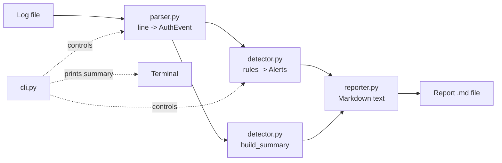

# Architecture

The program is a simple one-way pipeline. Each stage is its own small module so you can explain and test it separately.

## Modules

| Module | Job | Key functions |
|---|---|---|
| `models.py` | Data containers only (no logic) | `AuthEvent`, `Alert`, `Summary`, `AnalysisConfig`, `ParseResult` |
| `parser.py` | Read lines, recognise `Failed ...` / `Accepted ...` events, validate IP and date | `parse_line`, `parse_lines`, `parse_file`, `LogFileError` |
| `detector.py` | Apply the two rules, compute statistics | `detect`, `_repeated_failures`, `_success_after_failures`, `build_summary` |
| `reporter.py` | Turn results into Markdown, escape untrusted text, write the file | `render_report`, `write_report`, `md_escape`, `code_span` |
| `cli.py` | Parse arguments, run the pipeline, print summary, choose exit code | `main`, `build_parser` |

## Data flow

1. `parse_file` reads the file line by line (low memory use) and returns a `ParseResult` containing `AuthEvent` objects plus line counts.
2. `detect` groups failures by source IP, sorts them by time, and runs both rules. It returns a list of `Alert` objects sorted by severity then time.
3. `build_summary` counts events, unique IPs and the top failing IPs.
4. `render_report` builds the Markdown text. `write_report` saves it.
5. `cli.main` prints a short terminal summary and returns an exit code.

## Design decisions

- **Standard library only.** Nothing to install, so it runs anywhere and every line is explainable.
- **Dataclasses for data, functions for logic.** Easy for a beginner to read and to test.
- **Parser ignores what it does not understand.** Unknown lines are counted as "skipped" instead of crashing.
- **Only `Failed ...` lines count as failures.** sshd also writes `Invalid user ...` lines for the same attempt; counting both would double the numbers.
- **Per-IP rules.** Simple and explainable, with known weaknesses (see limitations).
- **Untrusted text is escaped.** Usernames come from whoever connects, so they are treated as hostile when written into the report.
- **Alerts never change the exit code.** Exit code `1` means the tool had a problem, not that it found something.
